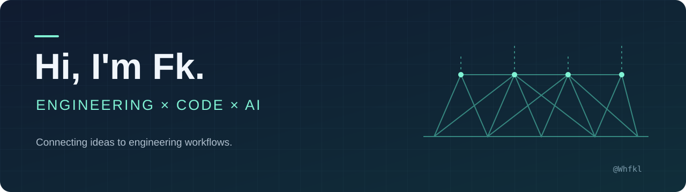

  

  <b>把工程软件与 AI 连接起来，让想法成为可运行的工具。</b> 
  Building practical connections between engineering software and AI.

  <a href="https://github.com/Whfkl?tab=repositories">Projects · 项目</a> &nbsp; / &nbsp;
  <a href="https://github.com/Whfkl/Abaqus-Control-MCP/issues">Discuss · 交流</a>

## About me / 关于我

Hi, I'm **Fk**. My background is in **Civil Engineering at Dalian University of Technology**, and my public projects explore engineering automation, CAD development, and AI agent tools.

土木工程背景，来自大连理工大学。关注工程软件自动化、CAD 二次开发，以及 AI Agent 与工程工作流的连接。

- **Engineering × AI** — connecting agents to live Abaqus/CAE and CAD sessions.
- **Tools that run** — building bridges, plugins, and scripts for practical workflows.
- **Beyond engineering** — experimenting with music, graphics, and creative coding.

## Selected projects / 代表项目

| Project | What it does |
| :--- | :--- |
| **[Abaqus-Control-MCP](https://github.com/Whfkl/Abaqus-Control-MCP)** | Connects MCP clients to a live Abaqus/CAE session for modelling and simulation workflows. 连接 AI 与 Abaqus/CAE 的本地 MCP 桥接工具。 |
| **[abaqus-cae-skill](https://github.com/Whfkl/abaqus-cae-skill)** | An Agent Skill and CLI for live CAE control and collaborative modelling. 面向实时 CAE 操作与协同建模的 Skill 和命令行工具。 |
| **[zwcad-control-mcp](https://github.com/Whfkl/zwcad-control-mcp)** | A local MCP control bridge for ZWCAD 2024–2026. 让 AI 工具连接中望 CAD。 |
| **[genCable](https://github.com/Whfkl/genCable)** | Generates FLAC3D cable elements from AutoCAD lines. 从 CAD 线条生成 FLAC3D cable 单元。 |
| **[ColorChord](https://github.com/Whfkl/ColorChord)** | A chord quantization tool exploring music through code. 色彩和声：和弦量化工具。 |
| **[DancingTree](https://github.com/Whfkl/DancingTree)** | An AI-agent-automated Abaqus modelling and simulation experiment. 用 AI Agent 自动建模与仿真的舞动分形树。 |

## Toolbox / 常用工具

**Languages** &nbsp; Python · C# · C++ · JavaScript  
**Engineering** &nbsp; Abaqus/CAE · AutoCAD · ZWCAD · FLAC3D  
**Automation** &nbsp; MCP · Agent Skills · CLI · CAD plugins

---

  Engineering problems. Working code. Open possibilities.

